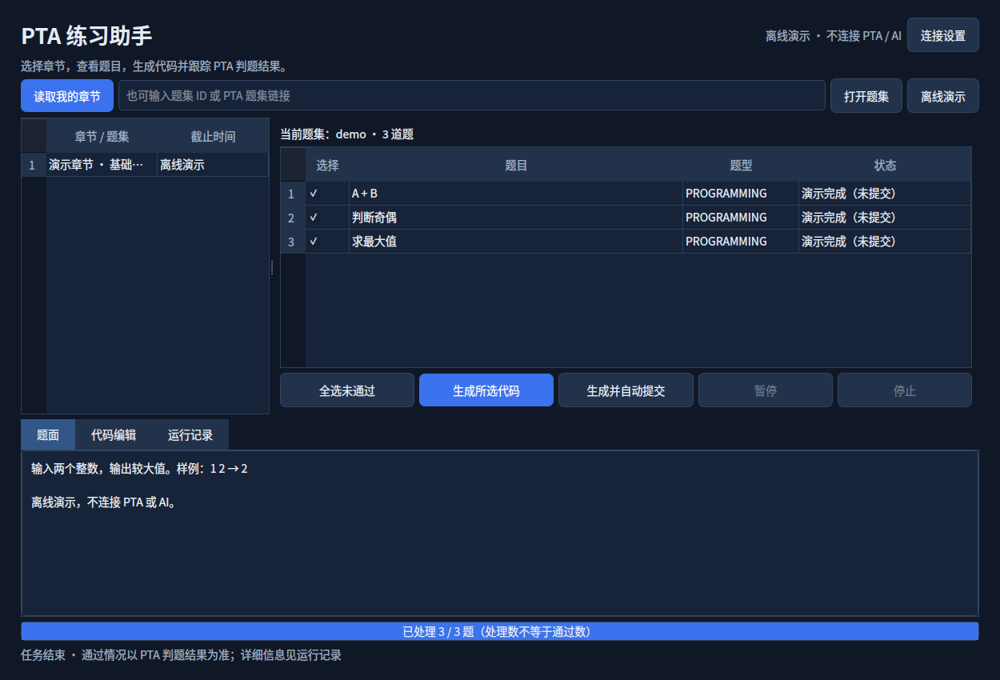

# PTA 练习助手

拥有桌面 GUI 的 PTA 编程练习助手，可读取账号有权访问的题集，接入兼容 Chat Completions 的模型服务，生成代码、提交并显示判题进度。

当前版本：**v1.2**。请仅在课程和平台允许 AI 辅助及自动提交的练习中使用。



## 功能

- 手动填写 PTA Cookie，读取进行中的题集，或通过题集 ID / 链接打开。
- 二级题目列表、题面查看、完成状态同步，运行时可滚动查看列表。
- 自定义 AI 接口地址、API Key、模型名称和编译器。
- 生成代码后查看和编辑，也可批量生成并自动提交。
- 每题尝试次数上限、判题失败后修改、达到上限自动进入下一题。
- 暂停、继续及取消网络请求；停止后可以刷新章节或重新运行。
- 保存代码、提交编号与判题记录，恢复查询已有提交。
- 离线演示模式，不连接 PTA 或 AI 服务。

## 安装与运行

需要 Python 3.10 或以上版本和桌面环境。

```bash
git clone https://github.com/AM1100/pta-practice-assistant.git
cd pta-practice-assistant
python3 -m venv .venv
source .venv/bin/activate
python -m pip install -r requirements.txt
python app.py
```

Linux / macOS 也可执行 `bash 启动.sh`；Windows 安装 Python 后双击 `启动.bat`。首次启动脚本会联网安装依赖，Linux 可能需要安装 `python3-venv`。

如果仓库名不同，请将克隆地址替换为当前仓库地址。

## 使用

1. 点击“离线演示”，双击章节并选择题目，熟悉界面。
2. 在“连接设置”中填写自己的 Cookie 和 AI 配置。接口地址通常为 `https://服务地址/v1`，也可填写完整 `/chat/completions` 地址。
3. 在浏览器进入可练习的 PTA 题集，再点击“读取我的章节”或输入题集链接。
4. 选择题目，点击“生成所选代码”查看结果，或“生成并自动提交”开始真实提交。
5. 在设置中调整“每题最多尝试次数（含首次）”，范围 1–10。达到上限后自动进入下一题。

暂停会等待当前请求完成，点击继续可以恢复；停止会取消本地请求并结束任务，随后可刷新或重新运行。服务器已收到的提交不能撤回。若提交结果不确定，软件保存待核对状态，避免盲目重交。

完整说明见 [使用说明](使用说明.md)。

## 凭据与数据

- Cookie 仅发送给 PTA；题面、代码及判题反馈会发送给你配置的 AI 服务。
- Cookie 和 API Key 默认只在内存中保留，可选择系统凭据库。凭据库不可用时不会明文保存。
- 配置、代码和任务记录保存到系统应用数据目录，具体位置显示在“运行记录”。
- 请勿将自己的 Cookie、API Key、配置文件、题目答案或运行记录提交到仓库。

## 范围与限制

目前支持 `PROGRAMMING` 和 `CODE_COMPLETION`。不支持图片题面理解、多代码空位结构、自动开始考试或交卷。软件不在本机执行生成的代码，正确性依赖 PTA 判题，AI 生成不保证通过。

PTA 接入使用网页接口，接口变化可能导致不兼容。测试使用离线演示和本机 HTTP 服务模拟请求，尚未完成真实 PTA 账号与真实 AI 服务的端到端验证。

## 开发与验证

```bash
QT_QPA_PLATFORM=offscreen python test_app.py
python app.py --transport-check
```

13 项测试覆盖任务上限、判题恢复、避免重复提交、凭据隔离、列表滚动，以及真实本机网络请求取消后恢复界面并重新运行。

Linux 打包示例：

```bash
python -m pip install pyinstaller
pyinstaller --noconfirm --windowed --onedir --name PTA-Assistant app.py
./dist/PTA-Assistant/PTA-Assistant --transport-check
```

Windows 的可执行文件需要在 Windows 上构建，本项目当前仅在 Linux x86_64 上验证打包。

## 第三方代码

`pta/` 目录包含改编自 [pintia-problemset-toolkit](https://github.com/lj200612/pintia-problemset-toolkit) 的代码，采用 MIT 许可证；版本与声明见 [THIRD_PARTY_NOTICES.md](THIRD_PARTY_NOTICES.md) 和 [THIRD_PARTY_LICENSE.txt](THIRD_PARTY_LICENSE.txt)。本项目不是 PTA 官方软件。

第三方许可证仅适用于对应第三方代码。本项目新增代码暂未选择开源许可证。
